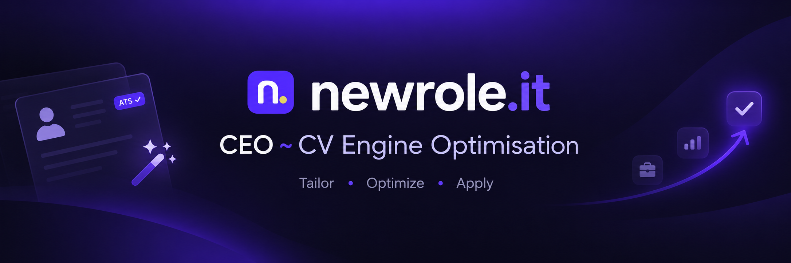
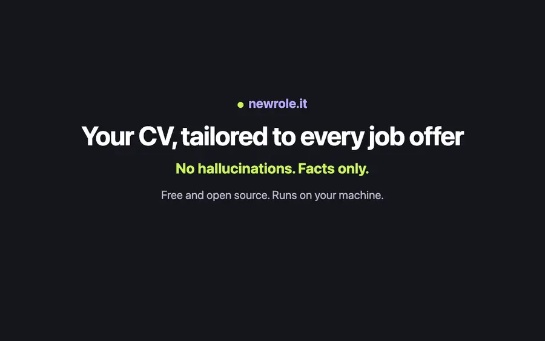

<p align="center">
  
</p>

<h3 align="center">A CV written for each job offer, from your own facts</h3>

<p align="center">
  Free, open-source CV builder for people in IT. Paste a link to a job offer and get a CV and a cover letter for it,<br>
  with a match score that shows what the offer asks for and what your CV lacks.<br>
  Runs on your machine. Works with Claude Code on your own subscription.
</p>

<p align="center">
  <a href="LICENSE"></a>
  <a href="https://nodejs.org"></a>
  <a href="https://nextjs.org"></a>
  <a href="#claude-code"></a>
  <a href="#faq"></a>
  <a href="CONTRIBUTING.md"></a>
</p>

<p align="center">
  <a href="#whats-in-the-repo">What's inside</a> ·
  <a href="#use-cases">Use cases</a> ·
  <a href="#features">Features</a> ·
  <a href="#quick-start"><b>Quick start</b></a> ·
  <a href="#chrome-extension">Extension</a> ·
  <a href="#claude-code">Claude Code</a> ·
  <a href="#faq">FAQ</a> ·
  <a href="#documentation">Docs</a>
</p>

<p align="center">
  <a href="apps/resume-engine-optimization/docs/screenshots/demo.mp4">
    
  </a><br>
  <sub>48 seconds, from a PDF to a CV for one offer. Waiting for the model is sped up. <a href="apps/resume-engine-optimization/docs/screenshots/demo.mp4">Watch the MP4</a> · <a href="apps/resume-engine-optimization/docs/screenshots/demo/scenario.md">Scenario and captions</a></sub>
</p>

## What's in the repo

| Part | What it does | Where |
|---|---|---|
| **Web app** | CV editor, offers, tailoring, match score, application tracker, answer bank | [apps/resume-engine-optimization](apps/resume-engine-optimization) |
| **Chrome extension** | Fills application forms, records what you sent, scores your LinkedIn profile | [apps/reo-extension](apps/reo-extension) |
| **MCP server** | 21 tools and 3 prompts, so Claude Code can do all of the above from the terminal | [apps/resume-engine-optimization/mcp](apps/resume-engine-optimization/mcp) |
| **Agent skills** | CV and job-search skills that load in Claude Code when you clone the repo | [.claude/skills](.claude/skills) |

One command installs and starts everything: `npm run go`. See [Quick start](#quick-start).

## Why newrole.it

- **Tailored, never invented.** The model proposes wording; code decides what may change. Employers, schools, dates and contact details are out of the model's reach, and it does not guess numbers.
- **A score you can check.** Code counts the match score, not the model: each requirement sits next to the fragment of your CV that shows it, or is marked as missing.
- **Your data, your machine.** Everything lives in a Postgres database on your computer.
- **Free.** No sign-up with us, no paid plan, no API key needed.

## Use cases

- **You apply to many offers** and each one needs a CV that speaks its language, without rewriting it by hand.
- **You want to know where you stand** before you apply: which requirements your CV shows and which it does not.
- **You lose track of applications**: who answered, what the next step is, which CV you sent.
- **You keep answering the same form questions** and want your earlier answers at hand.
- **You work in Claude Code** and want to run your job search from the terminal.

### One offer, start to finish

| Step | You | newrole.it |
|---|---|---|
| **1. Profile** | Upload your CV as a PDF, LinkedIn's data export, or paste text | Reads it into your profile and makes an editable CV from it |
| **2. Offer** | Paste the link to a job posting | Reads the whole posting from the employer's ATS or the page's JobPosting data |
| **3. Tailor** | Click **Tailor CV and letter** | Writes a CV and a cover letter for that offer, step by step in front of you, and opens the match score |
| **4. Answer** | Comment on what is missing, answer the questions about numbers | Runs the next round with your answers and scores the CV again |
| **5. Apply** | Download the PDF, or open the form and click Submit | The extension fills the form, attaches the CV and records the application in the tracker |

Your answers are kept as facts about you and used for every later offer.

## Features

### CV

- **A4 editor**: type on the page, add a photo, move entries and sections, add links
- **Three templates** (Classic, Colour band, Two columns) with accent colours or your own
- **Improve with AI**: Polish, Shorten or Strengthen one section, and see the changes before you apply them
- **Audit on the text**: missing keywords, vague phrases, gaps and length, with a score out of 100
- **Version history**: compare and restore any version; every exported PDF is kept with its version
- **Start from** your profile, a blank page, a PDF, an HTML file or a description in your own words

### Offers and tailoring

- **Offers by their link**: Greenhouse, Lever, Ashby, Workable, Teamtailor, Recruitee, Personio, Traffit, Pinpoint and other ATSes, or any page with schema.org JobPosting data
- **Match score**: required items weigh 70%, nice-to-haves 30%; a requirement counts only when code found it in your CV or profile
- **Keywords, an ATS checklist, your strengths and the offer's warning signs** on one page
- **Rounds with your comments**: each round rewrites the CV with what you said and stays in the history
- **A CV and a cover letter per offer**, in the offer's language, in the voice of your earlier letters

### Applications and answers

- **Tracker**: statuses from Applied to Offer, next steps with due dates, a timeline, notes, the CV that went out
- **Statistics**: funnel, response rate, median days to a reply, week by week
- **Google Sheet sync**, both ways, with no Google keys; CSV import and export
- **Replies from Gmail**: open an email, click the extension, confirm the new status
- **Answer bank**: every answer you gave to an application question, grouped by question, with per-company variants

### Profile and LinkedIn

- **Build your profile** from a CV PDF, LinkedIn's data export ZIP or pasted text
- **Your LinkedIn profile scored** from 0 to 100, with the main fixes ready to copy
- **LinkedIn and CV side by side**: differences in roles, dates and skills, plus a headline and an About section written from your CV

<p align="center">
  
</p>

Every screen and option is explained inside the app at `/features`.

## Quick start

You need [Node 22+](https://nodejs.org) and [Docker Desktop](https://www.docker.com/products/docker-desktop) running, on macOS or Linux (on Windows, use WSL). [Claude Code](https://claude.com/claude-code) is optional and recommended: it is the AI engine, on your own subscription.

```bash
git clone https://github.com/newrole-it/CEO.git newrole.it
cd newrole.it
npm run go
```

`npm run go` creates `.env` with fresh secrets, installs packages, starts Postgres in Docker, runs migrations, builds the Chrome extension, starts the app and opens http://127.0.0.1:43123/setup. The `/setup` page lists what is left to do. Run the command again any day: it skips what is already done.

> [!TIP]
> **No model? Still useful.** Without Claude Code or an API key, reading a CV by rules, the editor, the rule-based audit and the PDF all work. Tailoring and letters need a model.

## Chrome extension

`npm run go` builds it into `apps/reo-extension/.output/chrome-mv3`.

1. Open `chrome://extensions` and turn on Developer mode.
2. Click **Load unpacked** and choose that folder.
3. Chrome opens `/setup`. Click **Connect** there.

After a `git pull`, run `npm run go` and click Reload next to the extension. The popup is in Polish for now; `/features#extension` explains each switch, and [apps/reo-extension/README.md](apps/reo-extension/README.md) (in Polish) lists the supported sites.

> [!IMPORTANT]
> The extension never submits for you: it fills and records, you click Submit. It never fills passwords, hidden fields, card numbers, PESEL, EEO fields or consents, and it sends data only to your own newrole.it.

## Claude Code

The MCP server talks to the same database as the app; the app does not need to be running. Inside this repo, Claude Code offers it from `.mcp.json`: approve `newrole` once. From anywhere else:

```bash
claude mcp add newrole -s user -- npm --prefix /path/to/newrole.it run --silent mcp
```

Add `-e NEWROLE_USER_EMAIL=you@example.com` when the database has more than one account.

Things to ask:

- "Set up my profile from ~/Downloads/Profile.pdf"
- "Add this offer: https://jobs.lever.co/… and tailor my CV to it"
- "Help me apply to this offer"
- "I have a final interview on Thursday"
- "Review my applications and update the sheet"

<details>
<summary><b>All tools and prompts</b></summary>

| Area | Tools |
|---|---|
| Profile | `profile_get`, `profile_import` |
| Offers | `offers_list`, `offer_add`, `offer_get` |
| CV and answers | `cv_list`, `cv_get`, `cv_update`, `cv_export_pdf`, `answers_search`, `answer_save`, `answer_draft` |
| Applications | `applications_list`, `application_get`, `application_add`, `application_update`, `applications_export`, `applications_stats`, `sheet_status`, `sheet_sync`, `gmail_status` |
| Prompts | `onboard` (set up your profile), `apply` (one application end to end), `pipeline` (review your applications and the sheet) |

The tools' replies are in Polish for now.

</details>

<details>
<summary><b>Skills that come with the repo</b></summary>

They live in `.claude/skills`, and `.agents/skills` links to them for other agents. `newrole` explains the MCP tools. The CV and job-search skills come unchanged from [paramchoudhary/resumeskills](https://github.com/paramchoudhary/resumeskills) (MIT): `job-description-analyzer`, `resume-tailor`, `resume-ats-optimizer`, `cover-letter-generator`, `linkedin-profile-optimizer` and more. Each copied skill has a `SOURCE.md` naming the commit it came from.

</details>

## AI models

newrole.it picks a model by itself; `LLM_PROVIDER` in `.env` overrides it.

| Model | When | Notes |
|---|---|---|
| Claude Code (`claude -p`) | The `claude` binary is found | Your own subscription, no API keys |
| An OpenAI-compatible API | `LLM_API_KEY` is set and Claude Code is not found | Mainly for Docker |
| None | Neither | Rules only: CV reading, the editor, the audit and the PDF |

`/usage` shows runs, tokens and the cost at API prices. [configuration.md](apps/resume-engine-optimization/docs/configuration.md#models) has every model variable.

## Privacy

- **Your data stays with you.** Settings downloads it as JSON, deletes your CV and profile, or deletes the account.
- **Offers are read politely.** robots.txt and a per-source policy apply, with a pace and a daily cap per host. LinkedIn and job boards are never crawled.
- **LinkedIn stays untouched.** The extension scores only your own profile and clicks or changes nothing on LinkedIn.

## FAQ

**Does it send applications for me?**
No. The extension fills the form and records what you sent. You always click Submit yourself.

**Does it make things up to fit the offer?**
No. What the offer asks for and your data does not show is listed as a gap. If you have it, say so in a comment and the next round uses it.

**Is it really free?**
Yes. The only thing that can cost money is the model: Claude Code uses the subscription you already have, and an API key is billed by its provider.

**Will it find job offers for me?**
No. newrole.it works on the offers you bring, by their link.

**Which languages does it speak?**
The interface is in Polish and English. CVs and letters are written in Polish or English. The Chrome extension and the MCP tools' replies are in Polish for now.

## Maintenance

<details>
<summary><b>Updating, stopping, removing</b></summary>

- **Update:** `git pull`, then `npm run go`. Reload the extension in `chrome://extensions` afterwards.
- **Stop:** Ctrl+C in the terminal running `npm run go`. The database keeps running in Docker; `docker compose stop db` stops it too.
- **Remove:** export your data in Settings first. `docker compose down -v` deletes the database container and its volume, with all your data. Remove the extension in `chrome://extensions`, and the MCP server with `claude mcp remove newrole -s user` if you added it.

</details>

<details>
<summary><b>Troubleshooting</b></summary>

`npm run go` stops with a one-line reason and what to do. The usual ones:

| It says | Do this |
|---|---|
| newrole.it needs Node 22 or newer | `nvm install 22 && nvm use 22`, or install Node from nodejs.org |
| On Windows, run newrole.it inside WSL | Clone and run it in WSL |
| No database on 127.0.0.1:…, and Docker is not installed / not running | Start Docker Desktop and run `npm run go` again, or point `DATABASE_URL` in `.env` at a Postgres you already run |
| The database refused the password in .env | Something else answers on that port, or the Docker volume is from an older `.env`. `docker compose down -v` starts over with an empty database |
| Port 43123 is taken by another program | Stop it, or set `APP_ORIGIN="http://127.0.0.1:<another port>"` in `.env`. The extension only talks to http://127.0.0.1:43123 or to an https address set in its options, so keep 43123 if you use it |
| `/setup` says the database needs an update | Stop the app (Ctrl+C) and run `npm run go` |

If something else breaks, open an issue with the output of `npm run go`, your OS and Node version. Leave CV contents and anything from `.env` out of it.

</details>

<details>
<summary><b>Docker Compose</b></summary>

```bash
cp .env.example .env   # set SESSION_SECRET_KEY, OWNER_PASSWORD, POSTGRES_PASSWORD
docker compose up --build
```

Postgres and the web app, published on 127.0.0.1 only. Claude Code and headless Chrome are not in the image, so model calls need `LLM_API_KEY`.

</details>

<details>
<summary><b>Repository layout</b></summary>

Next.js 16 (the App Router and Server Actions), Prisma and PostgreSQL, an MCP server built on `@modelcontextprotocol/sdk`, and a Chrome extension built with WXT. npm workspaces; the app runs as one process, with no worker to start.

```
apps/
├── resume-engine-optimization/   newrole.it, the CV app (@newrole/app)
│   ├── src/  db/  mcp/  config/  UI and services, Prisma schema and migrations, MCP server
│   ├── packages/                 cv-core, cv-engine, cv-editor, profile, profile-ui, ats, offers,
│   │                             matching, llm, ui, app-kit
│   └── docs/                     configuration, accounts, applications, architecture, product plans
└── reo-extension/                the Chrome extension (WXT, its own lockfile)
```

[architecture.md](apps/resume-engine-optimization/docs/architecture.md) has the rules between them.

</details>

## Documentation

- **In the app:** `/features` explains every screen and option, `/setup` the install, `/changelog` every change
- [Configuration and running](apps/resume-engine-optimization/docs/configuration.md): every command and environment variable, Docker Compose, tests
- [Accounts, profile and privacy](apps/resume-engine-optimization/docs/accounts.md): sign-in, LinkedIn import, audits, your data
- [Applications, CV, answers and the extension](apps/resume-engine-optimization/docs/applications.md): the tracker, statistics, Google Sheet, Gmail, the answer bank
- [Architecture](apps/resume-engine-optimization/docs/architecture.md): the apps, the packages, and the rules between them

---

newrole.it is in active development and runs locally first. Privacy and terms are drafts pending legal review.

[Contributing](CONTRIBUTING.md) · [Changelog](CHANGELOG.md) · [Security](SECURITY.md) · [Code of conduct](CODE_OF_CONDUCT.md) · Licence: [AGPL-3.0-only](LICENSE)
