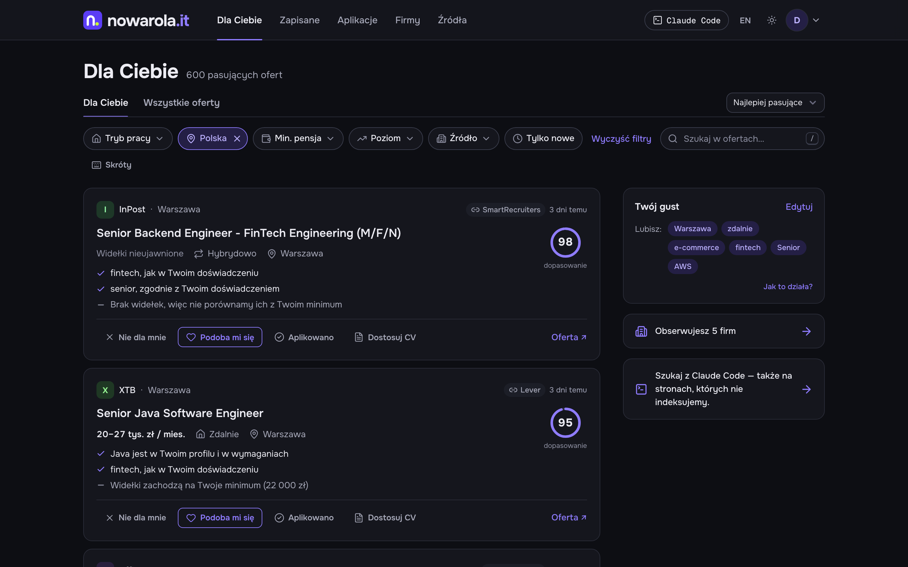
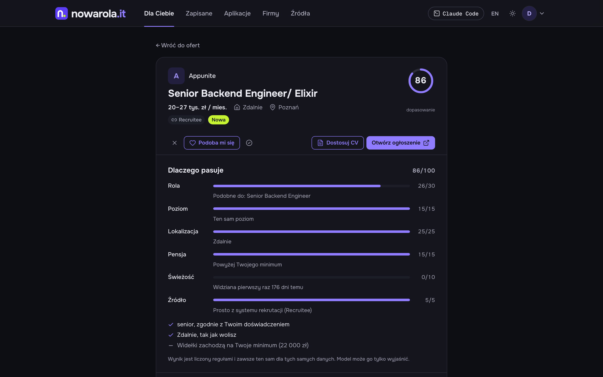
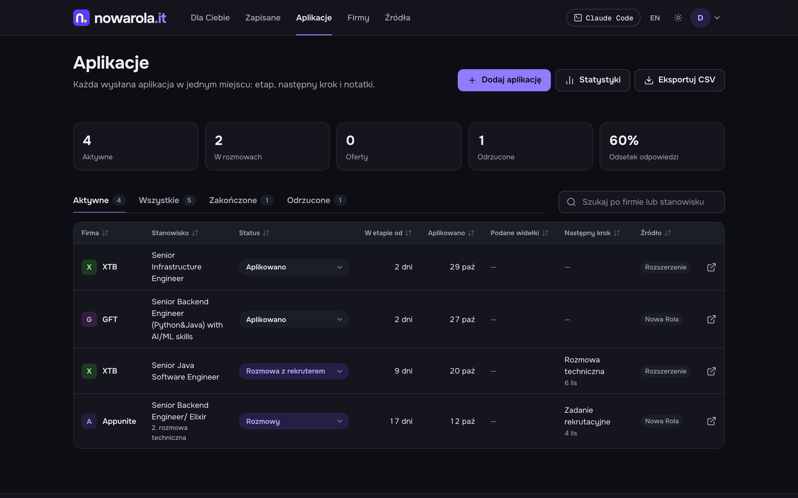
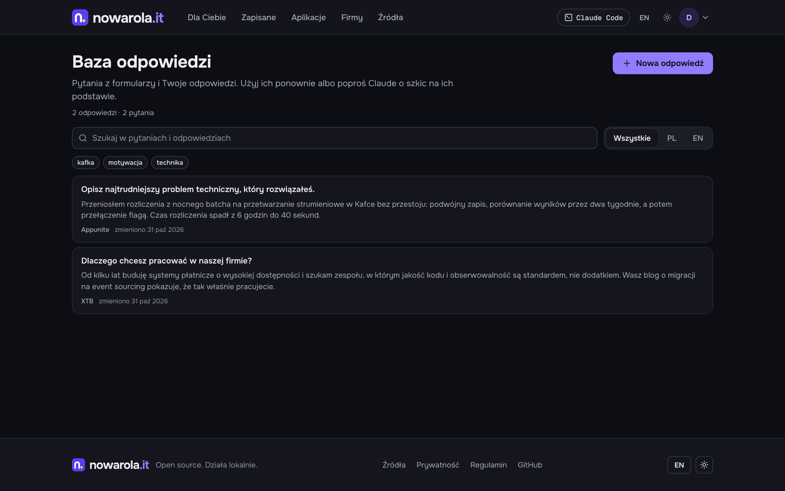
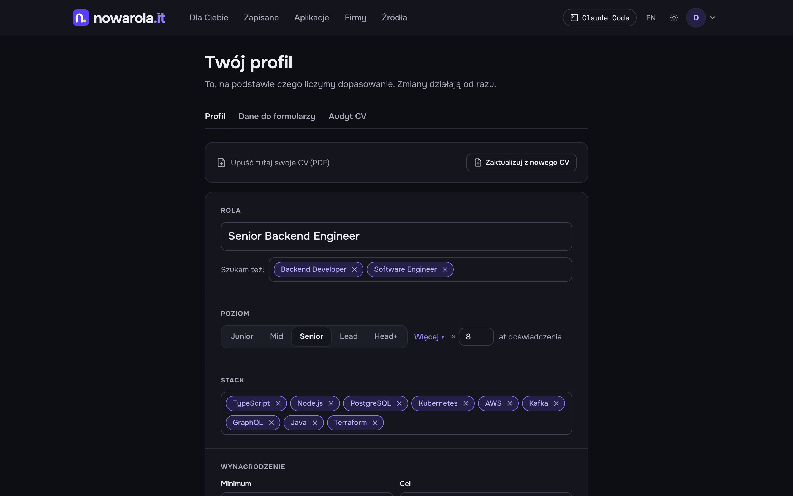
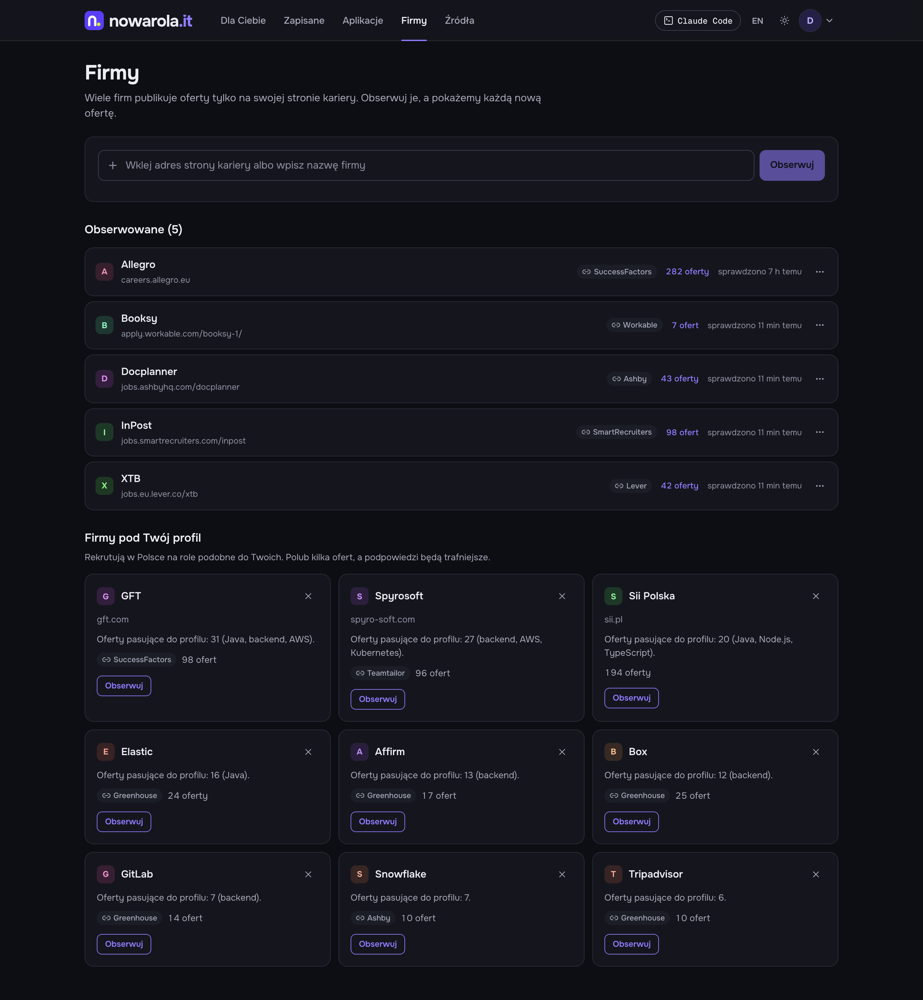
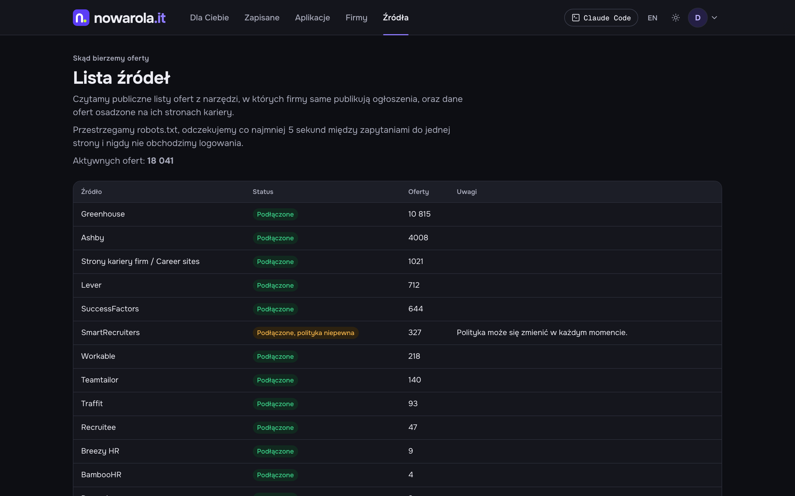
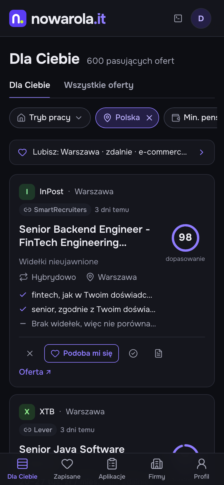
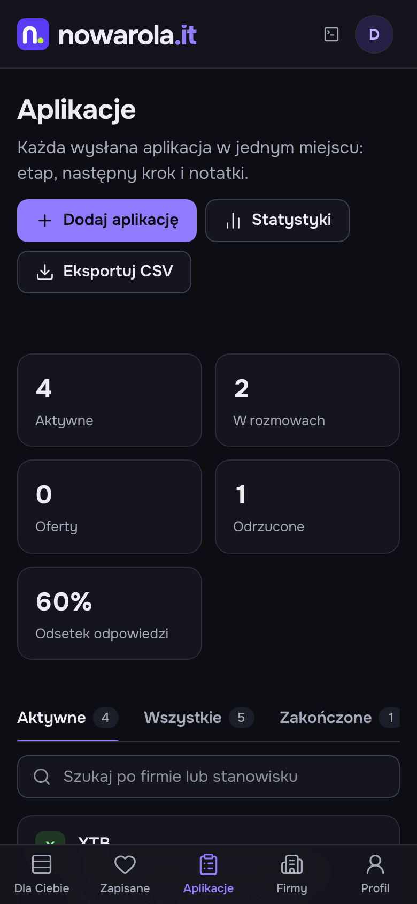
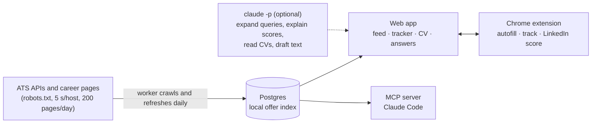

# Nowa Rola — tech jobs straight from employers, ranked for you.

A local-first job finder for the Polish tech market. It reads public career pages and ATS boards (not aggregators), keeps its own index, ranks every open offer against your profile, tracks your applications, tailors your CV, and lets Claude Code do all of it for you through MCP.

[](https://nowarola.it)
[](https://nodejs.org)
[](https://nextjs.org)
[](https://blitzjs.com)
[](#use-it-from-claude-code)
[](#contributing)

<p align="center">
  
</p>

<p align="center"><em>A 30-second tour, on a local install with a fictional profile. The offers are real public postings.</em></p>

[Demo](#screenshots) · [Features](#features) · [Quick start](#quick-start) · [Claude Code](#use-it-from-claude-code) · [How it works](#how-it-works) · [Docs](#documentation)

## Features

- 💻 **Runs on your machine.** Postgres in Docker, Node, and that is it. No billing, no API keys required.
- 🏢 **Offers from the source, not aggregators.** Greenhouse, Lever, Ashby, Workable, SmartRecruiters, Teamtailor, Recruitee, Personio, Traffit, Pinpoint, Workday and SuccessFactors employer sites, plus schema.org JobPosting on company career pages. Every result links to the original posting. [Every source and its policy](docs/sources.md) is public in the app.
- 🎯 **A deterministic match score with reasons.** Role, seniority, location, salary (monthly PLN, UoP and B2B normalised), freshness and source. The model may explain a score; it cannot change it.
- 🧠 **Learns your taste.** Reject or like with one key (J/K), swipe on the phone, tell it what you liked about an offer. Decided offers move out of the way; similar titles move with them.
- 🔍 **Search in Polish or English.** A phrase is expanded into related titles, seniority, synonyms and exclusions, then scored against the local index first, so results show before any crawl.
- 👤 **Your profile without a LinkedIn app.** Import from a CV PDF, LinkedIn's data export ZIP, pasted text, or let Claude read your own profile in your own Chrome.
- 📋 **Application tracker.** Stages from applied to offer, next steps, timeline, your stated salary, statistics with a funnel and response rates, CSV export, one-way sync to your own Google Sheet, and status updates from Gmail when the mail is unambiguous.
- 📄 **CV editor with real A4 pages.** Tailor a CV to an offer (code keeps facts, dates and employers intact), a cover letter on the same sheets, versions with compare and restore, an audit that underlines what to change, and a PDF printed from the same HTML.
- 💬 **Answer bank.** Every answer you gave to an application question, grouped by question with per-company variants, and Claude drafts from them.
- 🧩 **Chrome extension.** Fills application forms from your details, CV and answer bank on known ATS hosts, records the application when you submit, and scores your LinkedIn profile 0–100. It never fills passwords or consents and never submits for you.
- 🤖 **An MCP server for Claude Code.** 31 tools and 5 prompts: search, profile, taste, watched companies, applications, Gmail, CV, answers. Model calls run through `claude -p` on your own subscription.
- 🛡️ **Polite by design.** robots.txt, one request per 5 seconds per host, 200 detail pages per host per day, no logins or bot walls, no LinkedIn or Polish aggregators crawled, no recruiter contact data stored.

## Screenshots

**Ranked for you** — every offer with the score, the reasons, and the actions: reject, like, applied, tailor CV.

<a href="docs/screenshots/feed.png"></a>

**Why it matches** — the breakdown behind the number, six parts that always add up the same way for the same data.

<a href="docs/screenshots/offer.png"></a>

**Applications** — stage, time in stage, stated salary, next step and where it came from (the app, the extension, Claude, Gmail).

<a href="docs/screenshots/applications.png"></a>

**Answer bank** — what you said last time, by question and by company.

<a href="docs/screenshots/answers.png"></a>

**Profile, companies, sources** — what the ranking uses, the career pages you watch, and where every offer comes from with the policy per platform.

<p>
<a href="docs/screenshots/profile.png"></a>
<a href="docs/screenshots/companies.png"></a>
<a href="docs/screenshots/sources.png"></a>
</p>

**On your phone** — the same app, with a swipe stack for deciding on offers.

<p>
<a href="docs/screenshots/mobile-feed.png"></a>
<a href="docs/screenshots/mobile-applications.png"></a>
</p>

## Quick start

You need [Node 22+](https://nodejs.org) and [Docker Desktop](https://www.docker.com/products/docker-desktop) running (macOS or Linux; on Windows use WSL). [Claude Code](https://claude.com/claude-code) is optional and recommended: it is the AI engine, on your subscription.

```bash
git clone https://github.com/newrole-it/CEO.git
cd nowarola.it
npm run go
```

That is the whole install. `npm run go` creates `.env` with fresh secrets, installs packages, starts Postgres in Docker, runs migrations, builds the Chrome extension, starts the site and the worker, and opens http://127.0.0.1:43123/setup. Run it every day: it skips what is already done. Ctrl+C stops everything.

`/setup` lists what to do next, in order, and shows what already works:

| Step | How |
|---|---|
| Database, worker, offer index | `npm run go` handles them. The first offers appear within minutes |
| Claude Code | Optional. One command to install, one to sign in. No API keys |
| Account | Enter an email. The first email creates the account |
| Profile | Upload a CV PDF, or import your LinkedIn profile |
| Form details and CV | A short form, then create or import your CV |
| Chrome extension | Load one folder at chrome://extensions, click Connect |
| Claude Code MCP | Copy one command |
| Google Sheet, Gmail | Optional, in Settings |

> **Tip:** it works with no model at all. Without Claude Code or an API key, query expansion falls back to checked examples and every score is still computed by the rules.

### Docker Compose

```bash
cp .env.example .env   # set SESSION_SECRET_KEY, OWNER_PASSWORD, POSTGRES_PASSWORD
docker compose up --build
```

Postgres, the web app and a worker, published on 127.0.0.1 only. Claude Code and headless Chrome are not in the image, so model calls need `LLM_API_KEY`. See [docs/configuration.md](docs/configuration.md).

## Use it from Claude Code

Nowa Rola ships an MCP server that talks to the same Postgres as the app. Inside this repo Claude Code offers it from `.mcp.json`; approve `nowarola` once. From anywhere else:

```bash
claude mcp add nowarola -s user -- npm --prefix /path/to/nowarola.it run --silent mcp
```

Add `-e NOWAROLA_USER_EMAIL=you@example.com` when the database has more than one account. Keep the worker running (`npm run worker`) so watched companies get indexed; the web app does not need to be running.

Things to ask:

- „Załóż mój profil z ~/Downloads/Profile.pdf” (or: „przeczytaj mój profil LinkedIn w Chrome”)
- „Pokaż nowe oferty dla mnie z tego tygodnia”
- „Szukaj senior backend, zdalnie, od 25 tys.”
- „Ta oferta z Allegro mi się podoba” (Claude asks what you like about it and records it)
- „Znajdź mi oferty spoza agregatorów, jak ta z Allegro” (or the `/mcp__nowarola__hunt` prompt)
- „Na jakim etapie jestem z Docplanner?”, „Odrzucili mnie w OLX po rozmowach”, „Mam rozmowę finałową w czwartek”
- „Pomóż mi zaaplikować na tę ofertę” (the `apply` prompt: CV, answers, tracking)
- „Przejrzyj moje aplikacje i zaktualizuj arkusz” (the `pipeline` prompt)

| Area | Tools |
|---|---|
| Profile | `profile_get`, `profile_import` |
| Offers | `jobs_search`, `jobs_for_me`, `job_get`, `job_feedback`, `jobs_similar`, `offer_ingest`, `discovery_brief`, `index_refresh` |
| Companies | `companies_watch`, `companies_watched`, `companies_unwatch`, `companies_similar_context` |
| Applications | `applications_list`, `application_get`, `application_add`, `application_update`, `applications_export`, `applications_stats`, `sheet_status`, `sheet_sync`, `gmail_status`, `gmail_sync` |
| CV and answers | `cv_list`, `cv_get`, `cv_update`, `cv_export_pdf`, `answers_search`, `answer_save`, `answer_draft` |
| Prompts | `hunt`, `review`, `onboard`, `apply`, `pipeline` |

Claude never fetches LinkedIn or the Polish boards. Offers Claude adds go through the same URL checks and source policy as the crawler. The skill in `.claude/skills/nowarola` describes the same workflows.

## How it works



1. **Index.** The worker keeps a local copy of every open job on allowed boards and career pages: title, location, workplace, salary, a short excerpt and the canonical link. Closed jobs are detected on the next complete crawl.
2. **Expand.** A search phrase becomes related titles, seniority, synonyms and exclusions. Site queries are built in code; the model never writes them.
3. **Score.** Each offer gets a deterministic 0–100 score: title 30, seniority 15, location 25, salary 15, freshness 10, source 5. With a profile, salary floor, industry and seniority rank on top of the query.
4. **Decide.** Reject, like, apply, or tailor a CV. Decisions feed the ranking. Applications land in the tracker, answers in the bank.
5. **Automate.** The extension fills forms and records submissions; Gmail confirmations and rejections update stages; Claude Code runs the whole loop through MCP.

Model calls (query expansion, CV reading, match explanations, drafts) go through `claude -p` with built-in tools and MCP off, or through an OpenAI-compatible API, or not at all. Classifying indexed jobs as tech or not stays on rules, so the crawl never spends your subscription.

### Layout

| Path | What lives there |
|---|---|
| `src/app` | Next 15 App Router UI, Blitz auth, queries and mutations per feature |
| `src/server` | Domain services: adapters, crawler, discovery, index, search pipeline, matching, applications, CV, answers, autofill, Gmail, profile, privacy, security |
| `src/worker.ts` | Claims `BackgroundTask` rows: searches, crawls, sheet sync, Gmail. No Redis |
| `mcp/` | The MCP server for Claude Code (stdio), tools over the services in `src/server` |
| `matching/` | Query expansion, normalization, dedupe and the explainable scorer, with fixture tests |
| `extension/` | The Chrome extension (WXT): thin `entrypoints/`, logic in `lib/` |
| `config/` | Verified seed boards and source policies |
| `scripts/go.mjs` | `npm run go`: from a fresh clone to a running app |
| `db/` | Prisma schema, migrations, seed |
| `docs/`, `sources/` | Product plans, source packs and the legal notes behind the source policy |

## Documentation

- [Configuration and running](docs/configuration.md) — every command, every environment variable, Docker Compose, tests
- [Sources, scanning and matching](docs/sources.md) — the crawler rules, verified APIs, employer sites, the scorer
- [Accounts, profile and privacy](docs/accounts.md) — sign-in, LinkedIn import without a LinkedIn app, audits, your data
- [Applications, CV, answers and the extension](docs/applications.md) — the tracker, statistics, Google Sheet, Gmail, CV editor, answer bank
- [Chrome extension](extension/README.md) · [Product plans](docs/product) · [Source packs](sources)

## Contributing

Bug reports and pull requests are welcome. For anything larger, open an issue first.

```bash
npm run go          # first run: Postgres, migrations, extension, web + worker
npm run dev:all     # later: web on 127.0.0.1:43123 plus the worker
npm run test:db     # migrate the test database (once it exists, and after new migrations)
npm test            # vitest unit tests, the matching pack, node:test flow tests
npm run lint        # eslint
npx tsc --noEmit    # types
```

The flow tests need a `jobscanner_test` database on the same Postgres, and their connection string assumes the default `jobscanner` user and password. The UI is Polish by default with an English switch; copy lives in `src/app/i18n`.

## Status and licence

Nowa Rola is in active development and runs locally first. Privacy and terms are drafts pending legal review, and the source policy is documented, not legal advice. A licence has not been chosen yet; until it is, all rights are reserved by the author.
