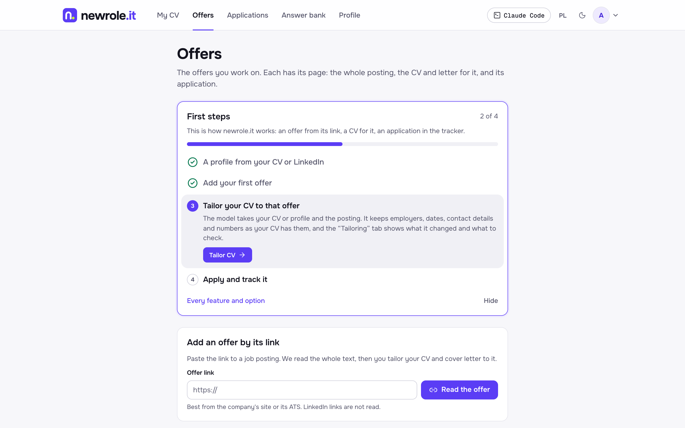
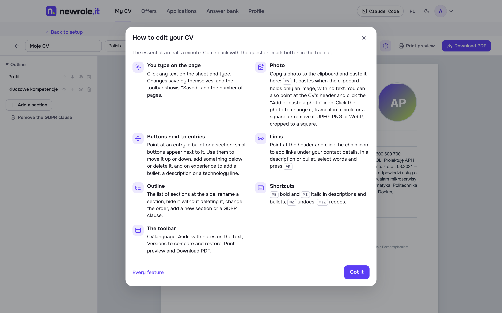
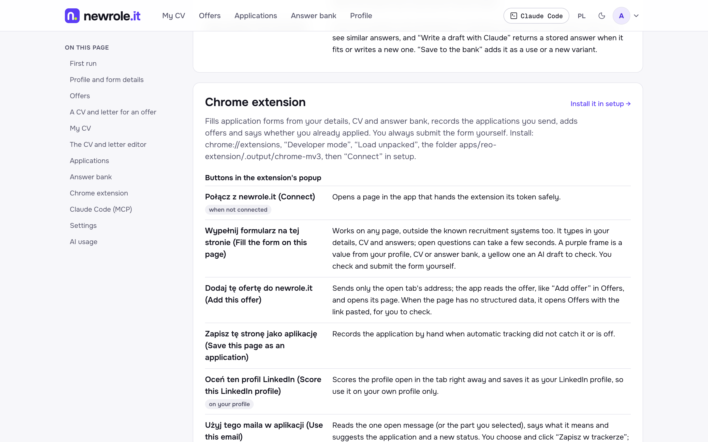

<p align="center">
  
</p>

<h3 align="center">CEO ~ CV Engine Optimisation</h3>

<p align="center">
  <i>SEO for your CV: the offer's keywords go only where your experience backs them.</i>
</p>

<p align="center">
  <b>Paste a link to a job offer. Get a CV and cover letter written for it, from your own facts.<br>
  Let the Chrome extension fill the form, and it records the application when you hit Submit.</b><br>
  Open source, runs on your machine, and works with Claude Code on your own subscription.
</p>

<p align="center">
  <a href="LICENSE"></a>
  <a href="https://nodejs.org"></a>
  <a href="https://nextjs.org"></a>
  <a href="#claude-code"></a>
  <a href="#faq"></a>
  <a href="CONTRIBUTING.md"></a>
</p>

<p align="center">
  <a href="#quick-start"><b>Quick start</b></a> ·
  <a href="#how-it-works">How it works</a> ·
  <a href="#features">Features</a> ·
  <a href="#chrome-extension">Extension</a> ·
  <a href="#claude-code">Claude Code</a> ·
  <a href="#faq">FAQ</a> ·
  <a href="#documentation">Docs</a> ·
  <a href="#contributing">Contributing</a>
</p>

<p align="center">
  
</p>

## Why newrole.it

- **Tailored, never invented.** The model proposes wording and order for one offer; code decides what may change. Employers, schools, dates, contact details, your photo and the order of your roles are out of its reach, and a line that gains a number your CV and profile do not have keeps your own text. New tool names are listed for you to check, not slipped in.
- **One loop, from link to application.** Add an offer by its link, get a CV and letter for it, let the extension fill the form, and the application lands in your tracker when you submit.
- **Your data, your machine.** Everything lives in a Postgres database on your computer. The model is Claude Code on your own subscription, an OpenAI-compatible API key, or none at all.
- **Made for Claude Code.** An MCP server with 21 tools and 3 prompts lets Claude set up your profile, add offers, tailor CVs, draft answers and update your tracker from the terminal.
- **Open source.** AGPL-3.0, with every screen, button and switch explained inside the app at `/features`.

## How it works

| Step | You | newrole.it |
|---|---|---|
| **1. Profile** | Upload your CV as a PDF, LinkedIn's data export, or paste text | Reads it into your profile: rules first, then one model call when you have a model |
| **2. Offer** | Paste the link to a job posting | Reads the whole posting from the employer's ATS or the page's JobPosting data, and keeps it on the offer's own page |
| **3. Tailor** | Click **Tailor CV and letter** | Writes a CV and cover letter for that offer. The **Tailoring** tab lists what changed, which of the offer's keywords your CV has, and what the offer asks for that your data lacks |
| **4. Apply** | Open the form, check it, click Submit | The extension fills the form from your details, CV and answer bank, attaches the CV, and records the application in the tracker |

A **First steps** card at the top of Offers and My CV walks you through these four steps the first time, and hides itself once they are done.

## Quick start

You need [Node 22+](https://nodejs.org) and [Docker Desktop](https://www.docker.com/products/docker-desktop) running, on macOS or Linux (on Windows, use WSL). [Claude Code](https://claude.com/claude-code) is optional and recommended: it is the AI engine, on your own subscription, with no API keys.

```bash
git clone https://github.com/newrole-it/newrole.it.git
cd newrole.it
npm run go
```

That is the whole install. `npm run go` creates `.env` with fresh secrets, installs packages, starts Postgres in Docker, runs migrations, builds the Chrome extension, starts the app and opens http://127.0.0.1:43123/setup. Run it again any day: it skips what is already done. Ctrl+C stops it.

`/setup` lists what is left, shows what already works and refreshes itself: Claude Code, your account, your profile, the details forms ask for, a CV to send, the Chrome extension, the MCP server and an optional Google Sheet. Locally an email is enough for the account: it opens at once and no email is sent.

> [!TIP]
> **No model? Still useful.** Without Claude Code or an API key, reading a CV by rules, the editor, the rule-based audit and the PDF all work. Tailoring and letters say they need a model.

## Features

### Your CV

- **A real A4 editor.** Type on the page, paste a photo, move entries and sections around, add links. Versions save themselves, and you can compare and restore any of them. The PDF is printed from the same HTML in Chrome.
- **An audit on the text.** Notes appear right on your CV: missing keywords, vague phrases, level and scope, gaps and inconsistencies, form and length, with a score out of 100 compared with the last audit. Without a model, the notes come from rules.
- **General CVs and CVs for offers.** Each general CV can have its own cover letter, written by the model, pasted or typed. CVs and letters for offers are grouped by offer, with the application's status. **Save as general** makes a tailored CV, with your edits, the new version of the general CV it came from.
- **Start from what you have.** Your profile, a blank page, a PDF or an HTML file. An uploaded PDF becomes editable in place and stays in the history as the original, and every PDF that leaves the app is kept with the version it was made from.

<p align="center">
  
</p>

### Offers and tailoring

- **Offers by their link.** Greenhouse, Lever, Ashby, Workable, Teamtailor, Recruitee, Personio, Traffit, Pinpoint and other ATSes are read through their APIs, other pages through their schema.org JobPosting data. A page with neither comes back as a form for you to check. The whole text is kept for you to read, edit or paste yourself.
- **A CV and a letter for every offer.** In the offer's language, from the general CV you pick, with optional notes for the model. The letter starts from your general letter, keeping its voice and, in the same language, your greeting and sign-off, and follows your last three letters. **Generate again** always starts from your base CV, not from the last result.

### Applications and answers

- **Application tracker.** Statuses from Applied to Offer, next steps with due dates, a timeline, your stated salary, notes, the CV that went out and what you answered in the form. Applications come in from the extension when you submit, from an offer's page, from a CSV, from your Google Sheet or through Claude Code.
- **Statistics.** A funnel, response rate, median days to a reply, where you drop out, week by week.
- **Your Google Sheet, both ways.** Two-way sync with a sheet of your own, with no Google keys. CSV import and export too.
- **Replies from Gmail.** Open a company's email, click the extension, confirm the new status. The extension has no access to your mailbox: it reads only the message you have open.
- **Answer bank.** Every answer you gave to an application question, grouped by question with per-company variants. Answers from forms you send with the extension come in by themselves, and Claude drafts new ones from them.

### Profile

- **No LinkedIn app needed.** Build your profile from a CV PDF, LinkedIn's data export ZIP, pasted text, or let Claude read your own LinkedIn profile in your own Chrome.
- **Your LinkedIn profile, scored.** On your own profile, the extension shows a score from 0 to 100, the change since the last score and the main fixes, with text ready to copy.

<p align="center">
  
</p>

**Every feature and option is explained inside the app at http://127.0.0.1:43123/features** (Features in the header, the footer and the account menu), the Chrome extension's buttons and switches included. The first time you open the CV editor, **How to edit** shows what the sheet does not.

## Privacy and trust

- **Your data stays with you.** It lives in a Postgres database on your machine. Settings downloads your data as JSON, deletes your CV and profile, or deletes the account.
- **Offers are read politely.** robots.txt and a per-source policy apply, with a pace and a daily cap per host. LinkedIn and job boards are never crawled. When you add an offer from one, its page is read once for the company, role and place; its text is read again when you tailor your CV and is not stored. A site that opts out of AI use gives the model only its company, role and place. Emails and phone numbers are removed from the stored text.
- **The extension never submits for you.** It fills and records; you click Submit. It never fills or sends passwords, hidden fields, card numbers, PESEL, EEO fields (gender, race, disability, age, date of birth, pronouns) or consents, and it sends only to your own newrole.it.
- **LinkedIn stays untouched.** The extension scores only your own profile, never other people's, and clicks or changes nothing on LinkedIn.

## Chrome extension

`npm run go` builds it into `apps/reo-extension/.output/chrome-mv3`. Open `chrome://extensions`, turn on Developer mode, click **Load unpacked** and choose that folder. Chrome opens `/setup`; click **Connect** there. After a `git pull`, `npm run go` rebuilds it: click Reload next to it in `chrome://extensions`.

The popup is in Polish for now. It has four switches, each with a one-line explanation under it; "Co robią te opcje?" opens `/features#extension`:

| Switch | Default | What it does |
|---|---|---|
| Automatyczne śledzenie wysłanych aplikacji<br>(track sent applications) | on | A submitted application form is recorded in the tracker with your answers. Off: use "Zapisz tę stronę jako aplikację" yourself |
| Pokazuj na ofertach, czy już aplikowano<br>(show on offers if you applied) | on | On an offer's page, a panel and a mark on the icon when you already applied to it or to that company |
| Oceniaj mój profil LinkedIn, gdy go otworzę<br>(score my LinkedIn profile) | on | Scores your own LinkedIn profile 0–100 when you open it, and shows what to change |
| Działaj na wszystkich stronach<br>(work on every site) | off | Off: the extension works by itself only on known recruitment systems, the job boards it knows, and LinkedIn; elsewhere you use the popup's buttons. On: Chrome asks for access to all https sites, and the form panel, the recording of applications and the "already applied" check work on every https page, such as a company's own careers site |

[apps/reo-extension/README.md](apps/reo-extension/README.md) (in Polish) lists the sites, what the extension sends and what it never does.

## Claude Code

newrole.it ships an MCP server that talks to the same database as the app; the app itself does not need to be running. Inside this repo, Claude Code offers it from `.mcp.json`: approve `newrole` once. From anywhere else:

```bash
claude mcp add newrole -s user -- npm --prefix /path/to/newrole.it run --silent mcp
```

Add `-e NEWROLE_USER_EMAIL=you@example.com` when the database has more than one account. Added the server before the rename, as `nowarola`? Run `claude mcp remove nowarola -s user` first (the old `NOWAROLA_USER_EMAIL` still works).

| Area | Tools |
|---|---|
| Profile | `profile_get`, `profile_import` |
| Offers | `offers_list`, `offer_add`, `offer_get` |
| CV and answers | `cv_list`, `cv_get`, `cv_update`, `cv_export_pdf`, `answers_search`, `answer_save`, `answer_draft` |
| Applications | `applications_list`, `application_get`, `application_add`, `application_update`, `applications_export`, `applications_stats`, `sheet_status`, `sheet_sync`, `gmail_status` |
| Prompts | `onboard` (set up your profile), `apply` (one application end to end: CV, answers, tracker), `pipeline` (review your applications and the sheet) |

Things to ask:

- "Set up my profile from ~/Downloads/Profile.pdf"
- "Add this offer: https://jobs.lever.co/… and tailor my CV to it"
- "Help me apply to this offer"
- "Where am I with Acme?" · "Beta rejected me after the interviews" · "I have a final interview on Thursday"
- "Review my applications and update the sheet"

The tools' own replies are in Polish for now.

The repository also carries skills, so anyone who clones it gets them in Claude Code with no install step. They live in `.claude/skills`, and `.agents/skills` links to them, next to the skills `npx skills` installs there for other agents (`skills-lock.json`). `newrole` explains the MCP tools. The CV and job-search skills come unchanged from [paramchoudhary/resumeskills](https://github.com/paramchoudhary/resumeskills) (MIT): `job-description-analyzer`, `resume-tailor`, `resume-ats-optimizer`, `resume-bullet-writer`, `resume-quantifier`, `cover-letter-generator`, `linkedin-profile-optimizer` and 15 more. `miodkuj` and `humanizer-zh` keep the writing natural in Polish and English. Each copied skill has a `SOURCE.md` naming the commit it came from.

## AI models

newrole.it picks a model by itself; `LLM_PROVIDER` in `.env` overrides it.

| Model | When | Notes |
|---|---|---|
| Claude Code (`claude -p`) | The `claude` binary is found | Your own subscription, no API keys. `haiku` by default, `sonnet` for answer drafts and application forms |
| An OpenAI-compatible API | `LLM_API_KEY` is set and Claude Code is not found | `gpt-4o-mini` by default; an xAI base URL works the same way. Mainly for Docker |
| None | Neither | Rules only: CV reading, the editor, the audit and the PDF |

`/usage` shows how much work the model did: runs, tokens and the cost at API prices. [configuration.md](apps/resume-engine-optimization/docs/configuration.md#models) has every model variable.

## FAQ

**Will it make me a CEO?**
No, but your CV gets the title. CEO stands for CV Engine Optimisation: newrole.it puts the offer's keywords where your experience backs them. What the offer asks for and your data does not show goes on a list of gaps instead of into the CV; if you have it, add it yourself.

**Does it send applications for me?**
No. The extension fills the form and records what you sent, but you always click Submit yourself.

**Will it find job offers for me?**
No. newrole.it works on the offers you bring, by their link. The engine that finds offers on its own (crawling ATS boards, watched companies, a ranked feed) is not part of newrole.it; it is meant for a separate deployment.

**Do I need an API key?**
No. With Claude Code, model calls run on your own subscription. Without any model, the rule-based parts still work.

**Which languages does it speak?**
The interface is in Polish and English: the language you pick in the header, or else your browser's (Polish when your browser prefers Polish, English otherwise). CVs and letters are written in Polish or English, and a document in another language than your CV is a translation. The Chrome extension and the MCP tools' replies are in Polish for now.

## Updating, stopping, removing

- **Update:** `git pull`, then `npm run go`. It installs new packages when the lockfile changed, runs new migrations and rebuilds the extension; reload the extension in `chrome://extensions` afterwards.
- **Stop:** Ctrl+C in the terminal running `npm run go`. The database keeps running in Docker; `docker compose stop db` stops it too.
- **Remove:** export your data in Settings first. `docker compose down -v` deletes the database container and its volume, with all your data. Remove the extension in `chrome://extensions`, and the MCP server with `claude mcp remove newrole -s user` if you added it.

## Troubleshooting

`npm run go` stops with a one-line reason and what to do. The usual ones:

| It says | Do this |
|---|---|
| newrole.it needs Node 22 or newer | `nvm install 22 && nvm use 22`, or install Node from nodejs.org |
| On Windows, run newrole.it inside WSL | Clone and run it in WSL |
| No database on 127.0.0.1:…, and Docker is not installed / not running | Start Docker Desktop and run `npm run go` again, or point `DATABASE_URL` in `.env` at a Postgres you already run |
| The database refused the password in .env | Something else answers on that port, or the Docker volume is from an older `.env`. `docker compose down -v` starts over with an empty database |
| Port 43123 is taken by another program | Stop it, or set `APP_ORIGIN="http://127.0.0.1:<another port>"` in `.env`. The extension only talks to http://127.0.0.1:43123 or to an https address set in its options, so keep 43123 if you use it |
| `/setup` says the database needs an update | Stop the app (Ctrl+C) and run `npm run go` |

If something else breaks, open an issue with the output of `npm run go`, your OS and Node version. Leave CV contents and anything from `.env` out of it.

## Docker Compose

```bash
cp .env.example .env   # set SESSION_SECRET_KEY, OWNER_PASSWORD, POSTGRES_PASSWORD
docker compose up --build
```

Postgres and the web app, published on 127.0.0.1 only. Claude Code and headless Chrome are not in the image, so model calls need `LLM_API_KEY`. See [configuration.md](apps/resume-engine-optimization/docs/configuration.md).

## Under the hood

Next.js 16 with Blitz.js 3, Prisma and PostgreSQL, an MCP server built on `@modelcontextprotocol/sdk`, and a Chrome extension built with WXT. newrole.it runs as one process: the Next server also does its background work (the Google Sheet sync and the company names the extension matches offers by), so there is no worker to start.

<details>
<summary><b>Repository layout</b></summary>

npm workspaces. Each app lives under `apps/` with the packages it is made of in its own `packages/` folder, its docs and its own tooling, so an app can leave the repository with everything it needs. The root holds only what runs them: `package.json` and the lockfile, `.env`, `npm run go` (`scripts/go.mjs`), `npm run check:boundaries` (`scripts/check-boundaries.mjs`), `docker-compose.yml`, the community files and the licence.

```
apps/
├── resume-engine-optimization/   newrole.it, the CV app (@newrole/app)
│   ├── src/  db/  mcp/  config/  Next 16 + Blitz UI and services, Prisma schema and migrations, MCP server
│   ├── packages/                 cv-core, cv-engine, cv-editor, profile, profile-ui, ats, offers,
│   │                             matching, llm, ui, app-kit
│   └── docs/                     configuration, accounts, applications, architecture, product plans
└── reo-extension/                the Chrome extension (WXT, its own lockfile)
```

| Path | What lives there |
|---|---|
| `apps/resume-engine-optimization` | newrole.it: the UI with Blitz auth (`src/app`), services (`src/server`), the MCP server (`mcp/`), Prisma schema and migrations (`db/`) |
| `…/packages/cv-core`, `cv-engine`, `cv-editor` | The CV and letter model and rules; tailoring, letters, the CV audit and printing; the A4 editor |
| `…/packages/profile`, `profile-ui` | The profile from a CV, a PDF or LinkedIn, its audit and the facts a model may use; the profile screens |
| `…/packages/ats`, `offers` | Reading one offer from its link on ATS boards and career sites; polite fetching, source policies, robots.txt |
| `…/packages/matching`, `llm`, `ui`, `app-kit` | Normalization, dedupe and FX rates; model clients; the design system; origin guard and interface language |
| `apps/reo-extension` | The Chrome extension; it talks to newrole.it's `/api/ext/*` |

[architecture.md](apps/resume-engine-optimization/docs/architecture.md) has the rules between them.

</details>

<details>
<summary><b>Which apps <code>npm run go</code> starts</b></summary>

`npm run go` reads one flag per app from `.env`, `"on"` or `"off"`:

| Flag | App | Default |
|---|---|---|
| `APP_RESUME_ENGINE_OPTIMIZATION` | newrole.it (`apps/resume-engine-optimization`) | on |
| `APP_REO_EXTENSION` | the Chrome extension build (`apps/reo-extension`) | on |

Another app under `apps/` joins by a `go` field in its `package.json`: its flag and default, the script that prepares it, the scripts it runs and its address. `npm run go` writes the flag into `.env` the first time it sees the app. An app whose folder is gone is skipped.

</details>

## Documentation

- **In the app:** `/features` explains every screen and option, `/setup` the install, `/changelog` every change
- [Configuration and running](apps/resume-engine-optimization/docs/configuration.md): every command, every environment variable, Docker Compose, tests
- [Accounts, profile and privacy](apps/resume-engine-optimization/docs/accounts.md): sign-in, LinkedIn import without a LinkedIn app, audits, your data
- [Applications, CV, answers and the extension](apps/resume-engine-optimization/docs/applications.md): the tracker, statistics, Google Sheet, Gmail, CV editor, answer bank
- [Architecture](apps/resume-engine-optimization/docs/architecture.md): the apps, the packages, and the rules between them
- [Publishing](apps/resume-engine-optimization/docs/publishing.md): what publishing the packages to npm would take
- [Chrome extension](apps/reo-extension/README.md) (in Polish) · [Product plans](apps/resume-engine-optimization/docs/product)
- [Changelog](CHANGELOG.md): every change by date

## Contributing

Bug reports and pull requests are welcome; for anything larger, open an issue first. [CONTRIBUTING.md](CONTRIBUTING.md) has the setup, the commands CI runs, the rules for interface copy and the changelog. A pull request needs your agreement to the [contributor licence agreement](CLA.md). Everyone follows the [code of conduct](CODE_OF_CONDUCT.md), and security problems go through [SECURITY.md](SECURITY.md), not a public issue.

```bash
npm run test:db     # create the test database if needed and migrate it
npm test            # every workspace's tests, the extension's, and the node:test flow tests
npm run lint && npm run typecheck && npm run check:boundaries
```

## Status and licence

newrole.it is in active development and runs locally first. Privacy and terms are drafts pending legal review, and the source policy is documented, not legal advice. Keeping the whole text of an offer a person added, and showing it to them, is new in this version; [plan-p0.md](apps/resume-engine-optimization/docs/product/plan-p0.md) §3 records the earlier decision to keep 300 characters and asks for a lawyer's view before a public version.

Licensed under the [GNU Affero General Public License v3.0 only](LICENSE) (`AGPL-3.0-only`). If you change it and let other people use it over a network, you have to offer them your source.
