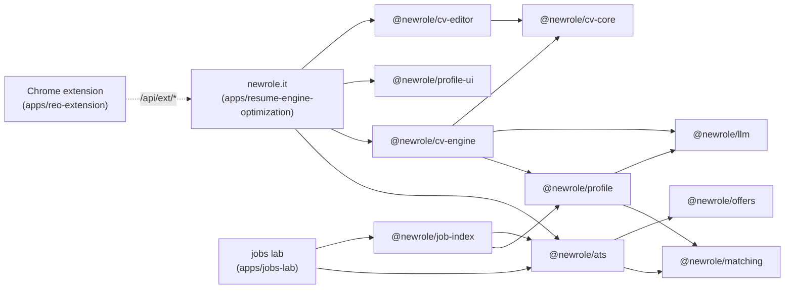

# Architecture: apps made of packages

The repository holds three apps, each under `apps/` with the packages it is made of in its own `packages/` folder:

- **newrole.it** (`apps/resume-engine-optimization`) is the CV app: the profile, the CV editor and tailoring, the offers a person adds by their link, the application tracker, the answer bank, the MCP server and the API the Chrome extension talks to.
- **The Chrome extension** (`apps/reo-extension`) fills application forms and adds offers to newrole.it through `/api/ext/*`.
- **Jobs lab** (`apps/jobs-lab`) is the engine that finds new offers on its own, [@newrole/job-index](../../jobs-lab/packages/job-index/README.md), and its test bench. It is not part of newrole.it's release and is meant to move to a repository of its own: it uses newrole.it's packages (`@newrole/ats`, `offers`, `matching`, `llm`, `profile`, `app-kit`, `ui`) as ordinary dependencies, and newrole.it uses nothing of it.

The rule that holds it together: **code lives once, in a package of the app that owns it; an app adds only its storage, its pages and its own wiring.**

## Layout

```
newrole.it/                         npm workspaces; the root holds .env, go.mjs and check-boundaries.mjs
└── apps/
    ├── resume-engine-optimization/ @newrole/app  newrole.it: src/ (Next, Blitz), db/ (Prisma), mcp/, docs/
    │   └── packages/
    │       ├── cv-core/     @newrole/cv-core     the CV and letter document model and its rules
    │       ├── cv-engine/   @newrole/cv-engine   writing with a model, the CV audit, printing HTML and PDF
    │       ├── cv-editor/   @newrole/cv-editor   the A4 editor and the tailoring start form (React, Next)
    │       ├── profile/     @newrole/profile     the profile: from a CV, a PDF or LinkedIn; its audit; salary rules
    │       ├── profile-ui/  @newrole/profile-ui  the profile screens (React, Next)
    │       ├── ats/         @newrole/ats         reading ATS boards and career sites; one offer from its link
    │       ├── matching/    @newrole/matching    normalization, places, dedupe, NBP rates
    │       ├── llm/         @newrole/llm         claude -p and OpenAI-compatible clients
    │       ├── offers/      @newrole/offers      polite fetching: source policies, robots.txt, safe fetch, hygiene
    │       ├── ui/          @newrole/ui          the design system: CSS, components, locale
    │       └── app-kit/     @newrole/app-kit     route-handler origin guard, interface language
    ├── reo-extension/       @newrole/extension   the Chrome extension (WXT, own lockfile, not a workspace)
    └── jobs-lab/            @newrole/jobs-lab    the offer engine's test bench, its database, docs/
        └── packages/
            └── job-index/   @newrole/job-index   the engine that keeps an index of offers
```

Each app carries its own tooling: a `tsconfig.base.json` for itself and its packages, `scripts/root-env.js` (the root `.env` for its `next.config.js`), `scripts/workspace-packages.js` (the `@newrole/*` packages it declares, for `transpilePackages`) and `scripts/test-db.mjs` (its test database).



newrole.it depends on nothing in `apps/jobs-lab`: `npm run check:boundaries` fails if any of its workspaces declares or imports one of jobs lab's, so deleting `apps/jobs-lab` leaves newrole.it whole.

## Rules

1. **A package never reaches into an app, and an app never into another.** No relative path out of its own folder, and only the packages its `package.json` declares. `npm run check:boundaries` (`scripts/check-boundaries.mjs`) fails on these, on a dependency cycle, and on an app depending on another app's workspaces where its `USES` list does not allow it (jobs lab may use newrole.it's packages; nothing else is allowed), for every workspace the root `package.json` lists. An app's own folders (`src/`, `db`, `mcp/`, `scripts/`) count as its own; its `packages/` folder does not. One reach across is declared there: newrole.it's tests read `apps/reo-extension/lib` to prove the two still agree on form fields and LinkedIn pages.
2. **A package keeps no data and knows no app.** Where behaviour needs storage or an app's identity, the package takes it as a port, and each app supplies its own:

   | Port                                                                                   | newrole.it                                                                                     | jobs lab                                                         |
   | -------------------------------------------------------------------------------------- | ---------------------------------------------------------------------------------------------- | ---------------------------------------------------------------- |
   | `configureAts({ http, takeDetailSlot, detailFetchesRemaining })` (`@newrole/ats/host`) | `src/server/fetch/ats.ts`: the bot User-Agent, the per-host pace and the daily cap in Postgres | `src/server/http.ts`: its own User-Agent, pace and cap in memory |
   | `configureJobIndex({ db, llm, heartbeat })` (`@newrole/job-index/host`)                | not used                                                                                       | `scripts/bind.ts`: a Prisma client on the lab's own database     |
   | `LlmCacheStore` (`@newrole/llm/common`)                                                | Postgres `LlmCache`: `src/server/llm/cache.ts`                                                 | —                                                                |
   | `CvEditorBackend` (`@newrole/cv-editor/backend`)                                       | `src/app/cv/backend.ts`: Blitz mutations                                                       | —                                                                |
   | The profile screens' calls (`@newrole/profile-ui`, as props)                           | `src/app/profile/profile-ui.ts`                                                                | —                                                                |
   | `createOriginGuard(appOrigin)` (`@newrole/app-kit/origin`)                             | `src/server/security/origin.ts` with `APP_ORIGIN`                                              | `src/server/guard.ts`                                            |

   `@newrole/job-index` is the one package that stores: in newrole.it's schema, through the client its app binds. It claims only its own `BackgroundTask` types, and newrole.it's worker only its own (`SHEET_SYNC`, `GMAIL_SYNC`), so both can run on one database.

3. **The writing is the same everywhere.** `tailorCv` and `writeCoverLetter` (`@newrole/cv-engine/tailor`) hold the prompts and the merge that keeps employers, dates, contact details and numbers as the CV has them. newrole.it's `src/server/cv/tailor.ts` only picks the base CV, reads the offer and keeps the result.
4. **Data rules travel with the code.** `@newrole/offers` applies the source policy and robots.txt and drops personal data; `@newrole/ats` refuses LinkedIn and keeps job boards link-only; `@newrole/llm` stores a prompt with a CV in it only when it is tied to a user; a CV or LinkedIn file imported into the profile is read in memory, and only the sections read from it are kept.
5. **An offer a person added is theirs.** `Job` keeps the facts of an offer and at most 300 characters of its text, shared by everyone who adds it (`src/server/offers/store.ts`, with `@newrole/ats/identity` keys, the same an index gives it). The whole posting, as it was read or as the person pasted it, is their `UserOffer` (`src/server/offers/service.ts`), shown to them and given to the model when they tailor (`savedOfferText` in `src/server/offers/text.ts`), and deleted with the offer or the account. A site that opts out of AI use gives the model only its company, role and place. [product/plan-p0.md](product/plan-p0.md) §3 recorded the earlier 300-character rule and asks for a lawyer's view before a public version.
6. **Source in, no build inside the repository.** A package's `exports` point at its TypeScript (`"./*": "./src/*.ts"`). Next compiles them through `transpilePackages`; tsx and vitest read TypeScript directly. Each package has its own `tsconfig.json` with no `baseUrl`, so `npm run typecheck` proves it compiles on its own, and its own tests.
7. **One `.env`, in the root, with a flag per app.** `npm run go` writes it there, with `APP_RESUME_ENGINE_OPTIMIZATION`, `APP_REO_EXTENSION` and the flag of every other app that has a `go` field in its `package.json` (jobs lab: `APP_JOBS_LAB`, off by default). Each app's `scripts/root-env.js` adds the root's `.env` to its Next environment (`next.config.js`); in newrole.it `src/server/load-env.ts` does it for the seed and scripts, `mcp/env.ts` for the MCP server. An app may keep variables only it reads in its own `.env.example` (jobs lab does).

## newrole.it's screens

- **Moje CV** (`/cv`): two tabs, _Ogólne_ (general CVs: new, from the profile, from a PDF or HTML) and _Pod oferty_ (the CVs and letters written for one offer, grouped by offer, with its application status).
- **Oferty** (`/offers`): add an offer by its link, then the list. A page that could not be read as a posting comes back as a draft with the text read from it, for the person to check. Each offer has its page (`/offers/[id]`): the whole text (edit, paste, read again), the CV and letter for it, its application and a note. Old `/jobs/...` links redirect here.
- **Aplikacje**, **Odpowiedzi**, **Profil**, **/setup**, **/settings**, **/usage**, **/connect**: as before.
- **The extension** adds the offer on the open tab from its popup (`POST /api/ext/offer`, the same `addOfferByLink`); a draft opens `/offers?add=<link>`, where the link is read at once.

## Next steps

These are proposals, not done:

1. **A job search deployment.** `@newrole/job-index` holds the engine and its search; its feed screens (ranked offers, saved, companies, sources, sync) were removed from newrole.it with this split and are in git history (commit `ac5855e` on main has them). A deployment would bring them back over the packages, with the ports above.
2. **The queue in one place.** newrole.it's worker and the engine's share `BackgroundTask` and the same claim and retry code, written twice (`apps/resume-engine-optimization/src/server/queue/worker.ts`, `apps/jobs-lab/packages/job-index/src/worker.ts`).
3. **Publishing.** [publishing.md](publishing.md) has what publishing the packages to npm would take.
