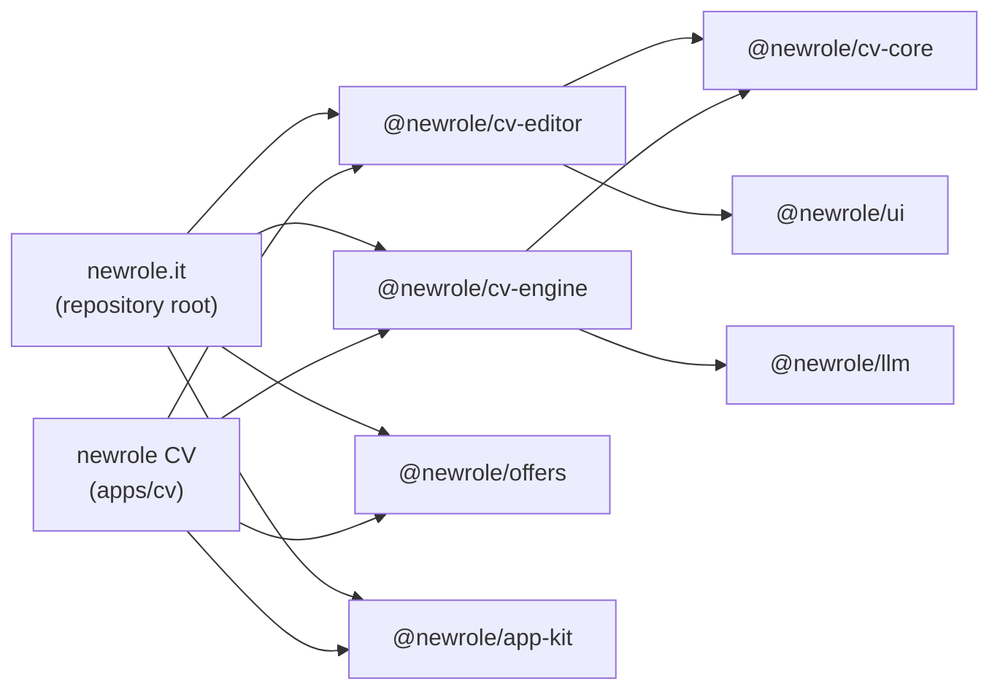

# Architecture: one product, parts that stand on their own

newrole.it is the whole product: the offer index, search and ranking, the application tracker, the CV editor and tailoring, the answer bank, the Chrome extension and the MCP server. Parts of it are useful without the rest, so they are packages that any app can use: **newrole CV** (`apps/cv`) is the first such app. It takes a link to a job offer and tailors a CV and a cover letter to it, with no database and no account. Each package can later be published as its own open-source project.

The rule that holds it together: **code lives once, in a package; an app adds only its storage, its pages and its own wiring.**

## Layout

```
newrole.it/                       npm workspaces; the root is the newrole.it app
├── src/ mcp/ db/ config/         newrole.it: pages, Blitz, Prisma, worker, MCP server (where they always were)
├── extension/                    the Chrome extension (own package, not a workspace)
├── matching/                     the matching pack (own lockfile; a workspace later, see Next steps)
├── packages/
│   ├── cv-core/    @newrole/cv-core    the CV and letter document model and its rules
│   ├── cv-engine/  @newrole/cv-engine  writing with a model, reading a PDF, printing HTML and PDF
│   ├── cv-editor/  @newrole/cv-editor  the A4 editor and the tailoring start form (React, Next)
│   ├── llm/        @newrole/llm        claude -p and OpenAI-compatible clients
│   ├── offers/     @newrole/offers     reading public job postings politely
│   ├── ui/         @newrole/ui         the design system: CSS, components, locale
│   └── app-kit/    @newrole/app-kit    route-handler origin guard, interface language
└── apps/
    └── cv/         newrole CV          offer link → tailored CV and letter, in files
```

| Package              | What it holds                                                                                                                                                                                                                                                                                        | Runs in          | Depends on   |
| -------------------- | ---------------------------------------------------------------------------------------------------------------------------------------------------------------------------------------------------------------------------------------------------------------------------------------------------- | ---------------- | ------------ |
| `@newrole/cv-core`   | CV schema (zod), sanitizing, edits, the atom flow and A4 pagination, letters, diffs, the tailoring merge and its truth checks (`tailor.ts`), audit rules, HTML import, pl/en detection, the views a store hands the editor (`views.ts`)                                                              | browser and Node | zod          |
| `@newrole/cv-engine` | The tailoring and cover-letter prompts and calls (`tailor.ts`), which language to write in, CV text → structured CV (`structure.ts`), PDF text (`pdf.ts`, unpdf), print HTML and Chrome PDF (`render.ts`), PDF and print responses (`http.ts`), the content hash for version history (`versions.ts`) | Node             | cv-core, llm |
| `@newrole/cv-editor` | The editor (`CvEditor`), its panels (versions, review, audit), the tailoring start form (`TailorStart`), their strings (`copy-cv.ts`, `copy-tailor.ts`) and CSS (`cv.css`, `tailor.css`). Every call goes through one `CvEditorBackend` (`backend.tsx`)                                              | browser (Next)   | cv-core, ui  |
| `@newrole/llm`       | `claude -p` (the person's own subscription) or an OpenAI-compatible API, JSON replies checked against a schema, prompt-injection guards (`wrapUntrusted`, `wrapLong`), a reply cache behind `LlmCacheStore`                                                                                          | Node             | zod (peer)   |
| `@newrole/offers`    | Source policies per platform, Polish boards and aggregator hosts, robots.txt, URL safety, the safe fetch (`createSafeFetch`), the polite page read, HTML to text, hygiene (personal data, AI opt-out), JSON-LD JobPosting, and `readPosting` (one offer from a link)                                 | Node             | undici       |
| `@newrole/ui`        | `styles.css` (tokens, base, buttons, fields, overlays, toasts…), `Button`, `primitives`, `interactive`, the `LocaleProvider` every package reads, shared strings, `relativeTime`                                                                                                                     | browser (Next)   | lucide-react |
| `@newrole/app-kit`   | `createOriginGuard` (refuse cross-site writes and DNS rebinding in route handlers), `languages` (cookie and Accept-Language → pl/en)                                                                                                                                                                 | Node and browser | —            |



Both apps also use `cv-core`, `llm` and `ui` directly; the arrows above show only what each package needs.

## Rules

1. **A package never reaches into an app.** No `src/`, `db`, `config/` or `mcp/` imports, no relative path out of its own folder, and only the packages its `package.json` declares. `npm run check:boundaries` (`scripts/check-boundaries.mjs`) fails on any of these and on a dependency cycle; CI runs it.
2. **A package keeps no data and knows no app.** Where behaviour needs storage or an app's identity, the package takes it as a parameter, and each app supplies its own:

   | Port                                                                   | newrole.it                                                                                       | newrole CV                                                         |
   | ---------------------------------------------------------------------- | ------------------------------------------------------------------------------------------------ | ------------------------------------------------------------------ |
   | `LlmCacheStore` (`@newrole/llm/common`)                                | Postgres `LlmCache`: `src/server/llm/cache.ts`, bound in `client.ts` and `writing.ts`            | none: every call goes to the model                                 |
   | `createSafeFetch({ userAgent, reserveSlot })` (`@newrole/offers/http`) | `src/server/security/safe-fetch.ts`: the bot User-Agent and the per-host pace shared in Postgres | `apps/cv/src/server/offers.ts`: its own User-Agent, pace in memory |
   | `CvEditorBackend` (`@newrole/cv-editor/backend`)                       | `src/app/cv/backend.ts`: Blitz mutations, with the audit                                         | `apps/cv/src/client/backend.ts`: its HTTP routes, no audit         |
   | `createOriginGuard(appOrigin)` (`@newrole/app-kit/origin`)             | `src/server/security/origin.ts` with `APP_ORIGIN`                                                | `apps/cv/src/server/http.ts`                                       |
   | Where documents live                                                   | Postgres (`src/server/cv/service.ts`, `versions.ts`, `tailor.ts`)                                | JSON files (`apps/cv/src/server/store.ts`)                         |

3. **The writing is the same everywhere.** `tailorCv` and `writeCoverLetter` hold the prompts and the merge that keeps employers, dates, contact details and numbers as the CV has them. newrole.it's `src/server/cv/tailor.ts` and newrole CV's `apps/cv/src/server/writing.ts` only pick the base CV, read the offer and keep the result.
4. **Data rules travel with the code.** `@newrole/offers` applies the source policy and robots.txt and drops personal data; an app keeps at most 300 characters of an offer (the legal reasons are in `docs/product/plan-p0.md` §3, and newrole CV follows them); `@newrole/llm` stores a prompt with a CV in it only when it is tied to a user.
5. **Source in, no build inside the repository.** A package's `exports` point at its TypeScript (`"./*": "./src/*.ts"`). Next compiles them through `transpilePackages`, and tsx and vitest read TypeScript directly. Each package has its own `tsconfig.json` with no `baseUrl`, so `npm run typecheck:workspaces` proves it compiles on its own, and its own tests (`npm test -w @newrole/cv-core`).
6. **One look.** The design system's CSS is `@newrole/ui/styles.css`; newrole.it loads Tailwind's base, then it, then its own pages' CSS, in the order `app.css` had them, so the pages render as before. An app that wants the same look loads the same files (`apps/cv/src/app/layout.tsx`).

## newrole CV (apps/cv)

Paste a link to an offer. newrole CV reads it with `readPosting`: the source policy and robots.txt first (LinkedIn and job boards are refused, as in newrole.it), then the page's schema.org JobPosting or its visible text. It keeps the company, the role, the link and a 300-character excerpt, and the full text in memory for 15 minutes. If the page cannot be read, type the company and role and paste the requirements into the guidance field, which goes to the model with that request only. Then the same start form as newrole.it's (`TailorStart`), the same model calls (`@newrole/cv-engine`) and the same editor (`CvEditor`), with versions, the print view and the PDF.

- Run it: `npm run cv` (development, http://127.0.0.1:43124), or `npm run cv:build` and `npm run cv:start`.
- Data: JSON files under `NEWROLE_CV_DATA`, by default `apps/cv/.data`: `documents/<id>.json` with their versions, and `offers/<id>.json`.
- Models: the same variables as newrole.it (`LLM_PROVIDER`, `CLAUDE_WRITING_MODEL`, `LLM_API_KEY`…). Without a model the app still edits and prints, and tailoring says it needs one.
- One person on their own machine: no account, bound to 127.0.0.1, and every write must come from its own pages (`createOriginGuard`). `APP_ORIGIN` names it when it runs under another name. `CV_USER_AGENT` replaces the User-Agent it reads offers with.
- What it does not have, and why: the CV audit compares a CV with what the indexed offers ask for, and newrole CV has no index; there is no candidate profile, so the model works from the CV alone.

## Next steps

These are proposals, not done:

1. **Job search as its own library and app.** Move `matching/` into `packages/matching` as a workspace (one lockfile). Move the ATS adapters, the crawler and discovery into `@newrole/offers`, which already has the polite-reading base they build on. They need ports for the index (save a job, identity, the daily detail budget, the shared host pace) like the CV ones. Then `apps/jobs`: search the boards of chosen companies, on files or SQLite.
2. **More of the CV into the engine.** The CV audit, with a port for the demand facts (newrole.it: its index; newrole CV: the one offer). The version-history rules, now written once for Postgres (`src/server/cv/versions.ts`) and once for files (`apps/cv/src/server/store.ts`).
3. **Publishing, one package at a time.** The packages are `private` and AGPL-3.0-only like the repository; the licence of each published package is the owner's choice. To publish one: build `dist/` (JavaScript and `.d.ts`) with `tsc`, publish a manifest whose `exports` point at `dist/`, drop `private`, and version with a tool such as changesets. A package can also become its own repository with `git subtree split --prefix packages/<name>`. Bottom-up keeps every dependency already published: cv-core, llm, app-kit, offers, ui, then cv-engine and cv-editor.
4. **The root app.** newrole.it stays at the repository root so `npm run go`, Docker, the MCP command people registered (`npm --prefix … run mcp`) and the docs keep working. Moving it to `apps/newrole` is possible later and changes no package.
